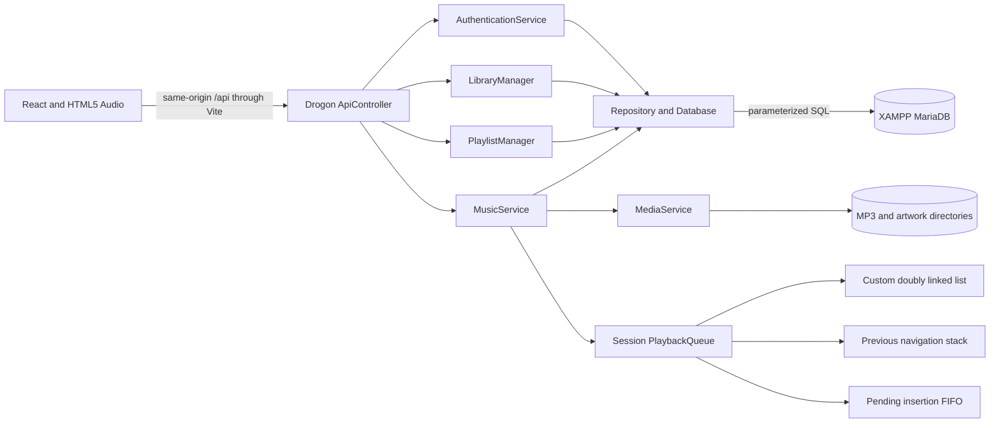

# Architecture and data flow

AuraStream is a local three-tier application. React renders the interface and controls the browser's audio element. Drogon runs the real C++ REST API. The existing XAMPP MariaDB server stores all authoritative relational records. MP3s and artwork are files on disk, never binary database blobs.

## Boundaries

`backend/src/main.cpp` loads environment settings, creates the database pool and services, and registers API routing. It starts four HTTP event-loop threads and an eight-worker task queue. SQL and password hashing run on workers rather than blocking Drogon's HTTP event loops. The regular database client has eight connections and a ten-second SQL timeout.

`ApiController` interprets HTTP method/path, validates request shape and origin, obtains the authenticated identity, and delegates. SQL lives in `Repository.cpp`; media and authentication logic live in their services. `Database` wraps result conversion and transactions. JSON envelopes use `data` on success and `error.message` on failure.

The browser never supplies an authoritative owner ID or role. Private endpoints derive user ID from a server-owned session. Every admin call re-reads the role from MySQL; role changes apply to subsequent requests without trusting a stale browser state. Public catalog/cover/audio routes allow discovery; favorites, queues, downloads and personal data require login. A public playlist is readable by link, but only its owner may change it.

## Authentication

Registration validates a name, username, email, password and matching confirmation. Libsodium generates an Argon2id password hash with a random salt, interactive memory/CPU limits and the encoded algorithm parameters. The database's unique username/email constraints close concurrent-registration races. Login verifies the stored hash and performs a dummy hash verification for nonexistent accounts.

The client receives a 256-bit random opaque token in a host-only `aura_session` cookie with HttpOnly, SameSite=Strict, path `/`, and a twelve-hour lifetime. Sessions reside only on the server. Local HTTP uses `Secure=false`; HTTPS deployments must set `COOKIE_SECURE=true`. Password changes revoke every session for that user. Logout removes the current session. Tokens are never written to localStorage.

Mutations require `X-Aura-Request: 1`. If an Origin header is present it must exactly match `APP_ORIGIN`. No permissive CORS headers are emitted. Authentication endpoints permit at most thirty attempts per peer IP per fifteen-minute window. This local demo does not support proxy-forwarded IP trust or shared rate limits between servers.

## Playback

1. A listener chooses a set of database-loaded songs.
2. React posts song IDs to `/api/queue`, with replace/current/shuffle options.
3. C++ validates every ID, locks the session queue, and builds its custom linked list through FIFO insertions.
4. React points the persistent `<audio>` element at `/api/songs/:id/audio` and calls `play()`.
5. The C++ service resolves the database file reference inside the approved songs directory, rejects missing/traversing paths, and sends real MP3 bytes. Single byte ranges include 206, Content-Range and Accept-Ranges; unsatisfiable/malformed ranges return 416.
6. The first actual `playing` event for a selected track posts a history event. Pause/resume does not repeatedly record it. MariaDB deduplicates repeated user/song events within thirty seconds under a user-row lock, then inserts history and increments the song play count in one transaction.
7. Next/previous use C++ node navigation and back history. Repeat-all wraps at the boundary. Repeat-one replays the current HTML audio source. Shuffle reorders the session list in C++.

`PlayerProvider` remains mounted above the routed content. Normal route navigation does not create a new audio element or reset its position. Autoplay rejection, decode/network errors and queue exhaustion are explicit UI states. Refresh preserves database data but does not silently resume audio.

## Download flow

Downloads require authentication and the song's `is_downloadable` flag. The service verifies that the controlled file exists, prepares an MP3 attachment response, then locks/rechecks the permission and commits the download row and incremented counter together. The browser saves the received Blob through an ordinary file download.

The database records an authorized request for an available file; a server cannot guarantee that a user completed a browser save or did not disconnect during transfer. Download history is not an offline media cache.

## Files and deletion

The server accepts at most 30 MB MP3s and 5 MB PNG/JPEG/WebP images, with a 36 MB total request ceiling. Generated random filenames replace browser-supplied names. Validation checks the extension and file contents: MPEG Layer III header after optional ID3 metadata, or raster signature. SVG and HTML are not accepted. Responses include `nosniff`.

Paths must be plain filenames, and canonical resolution must remain in `uploads/songs` or `uploads/covers`. Audio paths are omitted from public song JSON. If a song upload cannot be persisted, its new files are removed. Song deletion removes the database row first (using the existing foreign-key cascades), then attempts controlled file cleanup; cleanup failures are logged, not used to roll back a committed database delete. Maintain backups of both the database and uploads.

## Persistence and concurrency

MySQL owns users, songs, playlists, playlist order, favorites, history, download records and followed artists. Queue nodes, navigation stack, authentication sessions and rate buckets are ephemeral. Each session has its own mutex-protected queue; the session map has a separate mutex. Two devices can have independent playback sessions for the same user.

Playlist creation locks the owner row before checking the polymorphic limit. Playlist additions/reordering lock the playlist row. Reorder validates an exact permutation, so it cannot inject another song or silently lose a membership. Unique favorites and artist-follow keys keep repeated requests idempotent. Multi-statement operations wait for the transaction commit callback before returning success.

## Operational limits

This release is one loopback-bound process, not a distributed streaming service. No transcoding, DRM, adaptive bitrate, CDN, payment provider or ML recommendation service is present. “On repeat” is most-played ordering; “Fresh frequencies” is upload-time ordering; genre cards come from the catalog. HTTP media responses use local files; an external storage service is unnecessary for this project.
